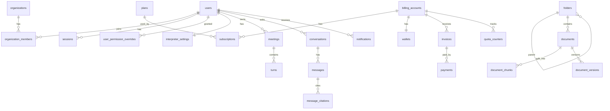

# 13 — Database Design (PostgreSQL 16 + pgvector) — authoritative

Rules: UUID v7 primary keys (`id uuid`, database-generated by `uuid_generate_v7()`), `created_at/updated_at timestamptz`, soft delete via `deleted_at` where marked (SD). Money in minor units (`bigint`, e.g. cents) + `currency char(3)`. Enums are Prisma enums. Sensitive text columns (transcripts) are encrypted at app level (`*_enc`). Required extensions: `vector`, `pg_trgm`, `citext`. Embedding dimension comes from env `EMBEDDING_DIM` (default 1024), MUST match the embedding model, and is limited to 2000 for the HNSW `vector` index. Set a non-default dimension before applying the initial migration with `pnpm db:set-embedding-dim`; never edit a migration already applied to a database.

## 1. High-level relations

## 2. Identity, tenancy, RBAC

**users** (SD): id, email `citext` unique, email_verified_at, password_hash (null for OAuth-only), `must_change_password` (force a seeded initial admin to replace its bootstrap password), name, avatar_url, locale (`vi|en|ja`), `platform_role` enum `SUPER_ADMIN|ADMIN|USER`, status enum `PENDING|ACTIVE|INACTIVE|SUSPENDED`, account_type enum `INDIVIDUAL|ENTERPRISE_MEMBER`, last_login_at, created_by (fk users, null), deactivated_at, deactivated_by, deactivation_reason.
**oauth_accounts**: id, user_id, provider, provider_account_id, unique(provider, provider_account_id).
**sessions** (refresh tokens): id, user_id, token_hash, user_agent, ip, expires_at, revoked_at.
**auth_tokens**: id, user_id, type enum `EMAIL_VERIFY|PASSWORD_RESET|INVITE`, token_hash, expires_at, used_at.
**organizations** (SD): id, name, slug unique, owner_user_id, status enum `ACTIVE|INACTIVE|SUSPENDED`, tax_code, address, billing_email, logo_url, settings jsonb, max_members.
**organization_members**: id, organization_id, user_id, org_role enum `ORG_ADMIN|ORG_MEMBER`, status enum `ACTIVE|INACTIVE`, invited_by, joined_at; unique(organization_id, user_id). Index(user_id).
**organization_invitations**: id, organization_id, email, org_role, token_hash, invited_by, expires_at, accepted_at.
**permissions**: key (pk, e.g. `users.create`), description, scope enum `PLATFORM|ORG`.
**role_permissions**: role (text: platform or org role), permission_key; pk(role, permission_key). Seeded from docs/14.
**user_permission_overrides**: id, user_id, permission_key, effect enum `ALLOW|DENY`, granted_by, created_at; unique(user_id, permission_key). Only SUPER_ADMIN can write.
**audit_logs**: id, actor_user_id, actor_role, action (e.g. `user.deactivate`), target_type, target_id, organization_id, ip, user_agent, metadata jsonb, created_at. Index(actor_user_id, created_at), (target_type, target_id), (action, created_at). Append-only (no update/delete in code).

## 3. Interpreter domain

**interpreter_settings**: user_id pk/fk, persona_name, avatar_url, voice_gender enum `MALE|FEMALE|NEUTRAL`, voice_style enum `WARM|PROFESSIONAL|ENERGETIC`, speed numeric(3,2), volume, duck_original_pct int, trigger_mode enum `AUTO|MANUAL|SUMMARY`, endpointing_ms int, default_source_lang, default_target_lang, save_history bool, storage_mode enum `LOCAL|CLOUD`.
**meetings** (SD): id, owner_id, organization_id null, type enum `BOT|ROOM`, title, platform enum `GOOGLE_MEET|ZOOM|TEAMS|INTERNAL`, meeting_url, source_lang, target_lang, status enum `CREATED|JOINING|LIVE|ENDED|FAILED|DENIED`, started_at, ended_at, duration_sec, customer_tag. Index(owner_id, started_at desc), (organization_id, started_at desc).
**meeting_participants**: id, meeting_id, display_name, external_id, lang, joined_at, left_at.
**turns**: id, meeting_id, participant_id null, speaker_label, lang, original_text_enc, translated_text_enc, emotion, started_ms, ended_ms, stt_confidence. Index(meeting_id, started_ms).
**meeting_summaries**: meeting_id pk, summary_md_enc, action_items jsonb, decisions jsonb, generated_at.
**glossary_terms**: id, owner_user_id null, organization_id null, source_lang, target_lang, source_term, target_term, note; check exactly one owner is set.
**bots**: id, meeting_id, vendor, vendor_bot_id, status, error. **rooms**: id, owner_id, organization_id, livekit_room, invite_code unique, status, ended_at.

## 4. Billing, subscriptions, quotas

**billing_accounts**: id, owner_type enum `USER|ORGANIZATION`, owner_id, provider customer id (`provider_customer_id`), currency, billing_email, tax_code, default_payment_method_id null; unique(owner_type, owner_id).
**plans**: id, code unique, name, description, price_minor, currency, `interval` enum `DAY|WEEK|MONTH|YEAR`, interval_count int default 1, `allowed_intervals` (`DAY|WEEK|MONTH|YEAR|CUSTOM` array, default `[MONTH]`) for customer-selectable billing cycles, included_interpret_minutes, included_ai_tokens, storage_quota_bytes, max_documents, max_members, features jsonb, is_active, is_public, audience enum `INDIVIDUAL|ENTERPRISE|ANY`, provider_price_id. Seeded commercial plans remain inactive until pricing, quotas, and payment-provider price IDs are configured.
**subscriptions**: id, billing_account_id, plan_id, status enum `TRIALING|ACTIVE|PAST_DUE|PAUSED|CANCELED|EXPIRED`, billing_interval enum `DAY|WEEK|MONTH|YEAR`, interval_count (user-chosen cycle; may differ from plan default), current_period_start, current_period_end, auto_renew bool, on_expiry_action enum `NOTIFY_ONLY|SWITCH_TO_FREE|PAUSE|CANCEL` (used when auto_renew=false), cancel_at_period_end bool, grace_until, provider_subscription_id, last_reminder_sent_at, canceled_at. Index(status, current_period_end).
**subscription_events**: id, subscription_id, type, payload jsonb, created_at.
**invoices**: id, billing_account_id, subscription_id null, number unique, status enum `DRAFT|OPEN|PAID|VOID|UNCOLLECTIBLE`, subtotal_minor, tax_minor, total_minor, amount_paid_minor, currency, period_start, period_end, due_at, paid_at, provider_invoice_id, hosted_url, pdf_url. **invoice_items**: id, invoice_id, description, quantity, unit_minor, total_minor, kind enum `PLAN|OVERAGE|TOPUP|ADJUSTMENT`.
**payments**: id, invoice_id null, billing_account_id, provider, provider_payment_id unique, amount_minor, currency, status enum `PENDING|SUCCEEDED|FAILED|REFUNDED`, failure_code, failure_message, attempt_no, paid_at.
**payment_methods**: id, billing_account_id, provider_method_id, brand, last4, exp_month, exp_year, is_default.
**wallets**: billing_account_id pk, balance_credits bigint (check >= 0). **wallet_transactions**: id, billing_account_id, type enum `TOPUP|USAGE|PLAN_GRANT|REFUND|ADJUSTMENT`, credits bigint, balance_after, ref_type, ref_id, created_at. Append-only.
**usage_events**: id, billing_account_id, user_id, organization_id null, meeting_id null, kind enum `STT|LLM_IN|LLM_OUT|TTS|BOT|VIDEO|EMBED|STORAGE|WEB_SEARCH`, quantity numeric, unit enum `SEC|TOKEN|CHAR|MIN|BYTE|QUERY`, provider_cost_micro_usd bigint, credits_charged bigint, created_at. Index(billing_account_id, created_at), (user_id, created_at). Partition by month when > 50M rows.
**quota_counters**: id, billing_account_id, metric enum `INTERPRET_MINUTES|AI_TOKENS|STORAGE_BYTES|DOCUMENT_COUNT|MEMBER_COUNT|SEARCH_QUERIES`, period_start, period_end, limit_value bigint, used_value bigint, last_threshold_notified int (0/80/90/100); unique(billing_account_id, metric, period_start). STORAGE_BYTES and counts are "current" gauges, others reset each period.
**member_quotas**: id, organization_id, user_id, metric, limit_value (enterprise admin can cap each member).
**webhook_events**: id, provider, event_id, type, payload jsonb, processed_at, error; unique(provider, event_id) → idempotency.

## 5. Notifications

**notifications**: id, user_id, organization_id null, type enum (`QUOTA_80`,`QUOTA_90`,`QUOTA_100`,`RENEWAL_REMINDER`,`PAYMENT_SUCCEEDED`,`PAYMENT_FAILED`,`SUBSCRIPTION_EXPIRED`,`DOC_READY`,`DOC_FAILED`,`MEMBER_INVITED`,`SYSTEM`), title, body, data jsonb, read_at, created_at. Index(user_id, read_at, created_at desc).
**notification_preferences**: user_id, type, in_app bool, email bool; pk(user_id, type).
**notification_deliveries**: id, notification_id, channel enum `EMAIL|IN_APP`, status, error, sent_at.

## 6. Knowledge base (RAG)

**folders** (SD): id, owner_id, organization_id null, parent_id null, name, path text (materialized, e.g. `/Projects/2024`), depth, visibility enum `PRIVATE|ORGANIZATION|SHARED`. Unique(owner_id, organization_id, parent_id, lower(name)) where deleted_at is null. Index(parent_id), gin(path gin_trgm_ops).
**documents** (SD): id, folder_id, owner_id, organization_id null, title, source_type enum `UPLOAD|URL`, source_url, original_filename, mime_type, extension, size_bytes, storage_key, sha256, language, status enum `UPLOADED|QUEUED|PARSING|CHUNKING|EMBEDDING|READY|FAILED`, error_message, page_count, chunk_count, version int, tags text[], uploaded_by, processed_at. Index(folder_id), (owner_id, created_at desc), (organization_id, status), gin(tags), unique(owner_id, sha256, folder_id) to detect duplicates.
**document_versions**: id, document_id, version, storage_key, size_bytes, sha256, created_by.
**document_chunks**: id, document_id, chunk_index, content, token_count, page_number null, section_title null, `embedding vector(EMBEDDING_DIM)`, `tsv tsvector` (generated from content, config `simple`), metadata jsonb. Indexes: HNSW on embedding (`vector_cosine_ops`), GIN on tsv, btree(document_id, chunk_index). Denormalized: owner_id, organization_id, folder_id (required for fast access-filtered search).
**access_grants**: id, resource_type enum `FOLDER|DOCUMENT`, resource_id, principal_type enum `USER|ORGANIZATION|ORG_ROLE`, principal_id, access enum `VIEW|EDIT|MANAGE`, granted_by. Unique(resource_type, resource_id, principal_type, principal_id).
**ingestion_jobs**: id, document_id, stage enum `PARSE|CHUNK|EMBED|INDEX`, status enum `QUEUED|RUNNING|DONE|FAILED`, attempts, error, started_at, finished_at.
**conversations**: id, user_id, organization_id null, title, folder_scope uuid[] null. **messages**: id, conversation_id, role enum `USER|ASSISTANT`, content, mode_web bool, mode_thinking bool, mode_deep bool, input_tokens, output_tokens, latency_ms, created_at.
**message_citations**: id, message_id, rank int, label text (e.g. `[1]`), source_kind enum `CHUNK|WEB`, chunk_id null, document_id null, url null, title, snippet, score real, page_number null.

## 7. System

**system_settings**: key pk, value jsonb, updated_by (e.g. `billing.markup`, `upload.max_mb`, `registration.enabled`). **feature_flags**: key, enabled, audience jsonb.

## 8. Migrations & seed

Prisma migrations in `apps/api/prisma/migrations`. Raw SQL migration enables extensions and creates HNSW/GIN indexes (Prisma cannot express them). `apps/api/prisma/seed.ts` creates: permissions + role_permissions, default plans (Free, Pro Monthly, Business Yearly, Enterprise), the first SUPER_ADMIN from env `SEED_SUPER_ADMIN_EMAIL/PASSWORD`, demo org, demo folder tree.
